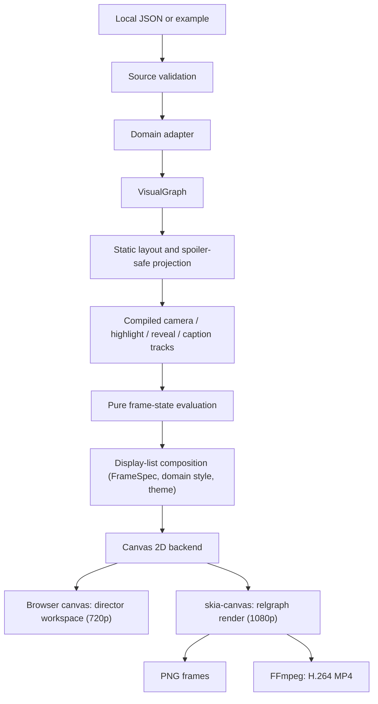

# ADR 001 — Video-first narrative graph

Status: **Accepted for prototype** · 2026-11-06

## Decision

Keep source formats, domain adapters, a neutral visual graph, deterministic frame projection and Canvas drawing separate. A JSON `presentation` is the storyboard; video frames are derived from an integer frame index, not from animation history. Human-authored coordinates remain fixed and no physics runs during playback. Video time and domain time are independent.

## B1 implementation

`packages/core/src/director/load.ts` reports source and graph errors with actionable diagnostics, rejects timed facts without an initial domain time, and keeps warnings distinct. `packages/core/src/graph/core.ts` removes invisible nodes, edges, groups, highlight IDs, camera targets and detail targets. If a scene explicitly references an invisible target, the frame state also withholds its title and narration. The studio only displays the current shot title; source-authored free text still requires editorial review because a program cannot reliably infer an untimed spoiler.

`packages/core/src/director/layout.ts` preserves supplied positions, places implicit reaction nodes from their participants and applies a stable fallback for missing coordinates. `packages/core/src/director/timeline.ts` deterministically compiles the authored shot list into camera/highlight/domain-time/reveal/caption tracks only after projection and redaction. The core frame evaluator in `packages/core/src/director/state.ts` resolves auto-fit camera positions and retains the original smooth transitions while reading safe compiled track values. It never steps a mutable animation clock. The per-shot safe projections in the timeline enable independent, out-of-order evaluation. `packages/render/src/compose.ts` turns the current projection, not domain objects, into a display list: plain path, text and group items plus the frame's spoiler-filtered accessible text. Its geometry comes from a `FrameSpec` (`packages/render/src/frame-spec.ts`): the stage, the title, graph and caption safe areas and a type scale, so 1080p is configuration rather than new code. Core receives only the camera's fit extents. Edge strokes, dashes, end markers, captions and node shapes come from domain style sheets (`packages/core/src/domains/*.style.ts`); the renderer holds no domain vocabulary, so physical association, regulatory influence, consumption, production and catalyst arcs keep distinct treatment through the biology style. Deterministic screen-space label placement avoids overlaps when space permits, hiding lower-priority labels when necessary. Step 4 adds 0.6-second node fade/scale, 0.8-second Bézier-prefix edge drawing and 0.3-second title/narration fades (the last caption holds to the end). New labels and detail cards appear after half the reveal; accessibility considers objects and subtitle text present from fade-in start. The workbench transcript and live region consume `DisplayList.a11y` from exactly the same composed frame. `packages/render/src/backends/canvas2d.ts` only translates items into Canvas calls, and `createCanvasRenderer` in `canvas.ts` combines the two behind the existing API.

The same backend runs headlessly. `packages/render/src/backends/skia.ts` (the Node-only `@relgraph/render/skia` entry) hands a skia-canvas `Canvas` to `createCanvasRenderer`, so composition, text measurement and drawing are the browser code paths; it adds only font registration and pixel read-back. `Canvas2D` lists exactly the context calls the backend makes, which both the DOM context and skia-canvas satisfy. Chromium also rasterizes with Skia, and at 720p the preview and the export differ in about 0.3% of pixels, mostly text antialiasing. Both backends use the vendored Noto CJK SC subsets in `packages/render/fonts`: the workspace through `@font-face` rules loaded before the first frame, the exporter through skia-canvas's font library, under the family names that lead `FONT_STACKS`. Characters outside the subset fall back to system fonts and are reported by the CLI.

`packages/cli` (`relgraph`) validates documents with the workspace's diagnostics text and renders films. Worker threads each load the document and draw whichever frame indices they receive; the main thread streams raw RGBA frames to FFmpeg in frame order. Because a frame depends only on `(document, layout, frame, options)`, the thread split cannot change a pixel. `examples/golden-frames.json` records RGBA hashes of key frames together with the skia-canvas version and a font digest, and `npm run check:export` enforces them only for those versions.

The integrated workspace is `demo/index.html`, served over local HTTP, with behavior in `apps/studio/src/studio.ts`. The private npm workspaces `@relgraph/core`, `@relgraph/render` and `@relgraph/cli` have explicit ESM/type exports and separate TypeScript builds; render depends on core's public interface, and the CLI on both. The studio resolves those names to source for development and its own Vite build, while installed consumers resolve the generated package outputs. `demo/standalone.html` remains the original independent prototype and is not the integrated renderer. Browser pixels depend on the browser version and rasterizer; determinism there means repeated frames in the same browser. Exported frames are reproducible for the same skia-canvas version and fonts. There is no export UI in the workspace yet; export is the `relgraph render` command. The step 4 implementation is on a draft branch with local acceptance, browser baseline comparisons and both MP4 re-exports still pending; existing stored SHA golden frames were not regenerated without a render.

## Consequences and limits

The graph projection cannot verify a source's scientific truth or turn unverified literary dates into facts. It cannot infer secrets in author-written labels, narration or summaries. Imported data and scripts require review before publishing; the Honglou fixture is explicitly provisional and the biology fixture synthetic. Large-scale layout, standards-based bio import, audio, 9:16 composition and an export UI remain future work.
