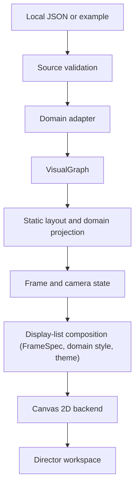

# ADR 001 — Video-first narrative graph

Status: **Accepted for prototype** · 2026-11-06

## Decision

Keep source formats, domain adapters, a neutral visual graph, deterministic frame projection and Canvas drawing separate. A JSON `presentation` is the storyboard; video frames are derived from an integer frame index, not from animation history. Human-authored coordinates remain fixed and no physics runs during playback. Video time and domain time are independent.

## B1 implementation

`packages/core/src/director/load.ts` reports source and graph errors with actionable diagnostics, rejects timed facts without an initial domain time, and keeps warnings distinct. `packages/core/src/graph/core.ts` removes invisible nodes, edges, groups, highlight IDs, camera targets and detail targets. If a scene explicitly references an invisible target, the frame state also withholds its title and narration. The studio only displays the current shot title; source-authored free text still requires editorial review because a program cannot reliably infer an untimed spoiler.

`packages/core/src/director/layout.ts` preserves supplied positions, places implicit reaction nodes from their participants and applies a stable fallback for missing coordinates. `packages/core/src/director/state.ts` resolves an auto-fit camera and smooth transitions from the requested frame. `packages/render/src/compose.ts` turns the current projection, not domain objects, into a display list: plain path, text and group items plus the frame's spoiler-filtered accessible text. Its geometry comes from a `FrameSpec` (`packages/render/src/frame-spec.ts`): the stage, the title, graph and caption safe areas and a type scale, so 1080p is configuration rather than new code. Core receives only the camera's fit extents. Edge strokes, dashes, end markers, captions and node shapes come from domain style sheets (`packages/core/src/domains/*.style.ts`); the renderer holds no domain vocabulary, so physical association, regulatory influence, consumption, production and catalyst arcs keep distinct treatment through the biology style. Deterministic screen-space label placement avoids overlaps when space permits, hiding lower-priority labels when necessary. `packages/render/src/backends/canvas2d.ts` only translates items into Canvas calls, and `createCanvasRenderer` in `canvas.ts` combines the two behind the existing API.

The integrated workspace is `demo/index.html`, served over local HTTP, with behavior in `apps/studio/src/studio.ts`. The private npm workspaces `@relgraph/core` and `@relgraph/render` have explicit ESM/type exports and separate TypeScript builds; render depends on core's public interface. The studio resolves those names to source for development and its own Vite build, while installed consumers resolve the generated package outputs. `demo/standalone.html` remains the original independent prototype and is not the integrated renderer. Browser pixels depend on fonts and rasterizer; determinism means repeated frames under the same rendering environment. There is a frame API, but no packaged batch encoder or production export UI yet.

## Consequences and limits

The graph projection cannot verify a source's scientific truth or turn unverified literary dates into facts. It cannot infer secrets in author-written labels, narration or summaries. Imported data and scripts require review before publishing; the Honglou fixture is explicitly provisional and the biology fixture synthetic. Large-scale layout, standards-based bio import, audio, 9:16 composition and production video export remain future work.
