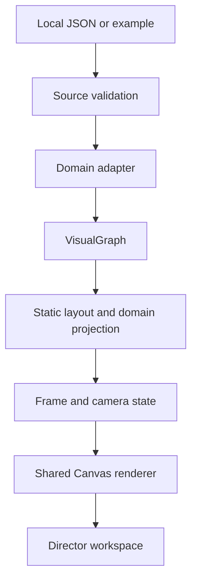

# ADR 001 — Video-first narrative graph

Status: **Accepted for prototype** · 2026-11-06

## Decision

Keep source formats, domain adapters, a neutral visual graph, deterministic frame projection and Canvas drawing separate. A JSON `presentation` is the storyboard; video frames are derived from an integer frame index, not from animation history. Human-authored coordinates remain fixed and no physics runs during playback. Video time and domain time are independent.

## B1 implementation

`src/director/load.ts` reports source and graph errors with actionable diagnostics, rejects timed facts without an initial domain time, and keeps warnings distinct. `src/graph/core.ts` removes invisible nodes, edges, groups, highlight IDs, camera targets and detail targets. If a scene explicitly references an invisible target, the frame state also withholds its title and narration. The studio only displays the current shot title; source-authored free text still requires editorial review because a program cannot reliably infer an untimed spoiler.

`src/director/layout.ts` preserves supplied positions, places implicit reaction nodes from their participants and applies a stable fallback for missing coordinates. `src/director/state.ts` resolves an auto-fit camera and smooth transitions from the requested frame. `src/render/canvas.mjs` renders the current projection, not domain objects. Physical association, regulatory influence, consumption, production and catalyst arcs retain distinct visual treatment and metadata. Deterministic screen-space label placement avoids overlaps when space permits, hiding lower-priority labels when necessary.

The integrated workspace is `demo/index.html`, served over local HTTP. `demo/standalone.html` remains the original independent prototype and is not the integrated renderer. Browser pixels depend on fonts and rasterizer; determinism means repeated frames under the same rendering environment. There is a frame API, but no packaged batch encoder or production export UI yet.

## Consequences and limits

The graph projection cannot verify a source's scientific truth or turn unverified literary dates into facts. It cannot infer secrets in author-written labels, narration or summaries. Imported data and scripts require review before publishing; the Honglou fixture is explicitly provisional and the biology fixture synthetic. Large-scale layout, standards-based bio import, audio, 9:16 composition and production video export remain future work.
