# 一切关系皆可图 · Generic graphs, derived encoding and layouts

Status: implemented on top of `main` (started at `663d5ec`, reconciled with `0f995b7`). This document describes the
`relgraph.graph/1` source format, how arbitrary kinds are turned into a visual
encoding, the layout strategies, and what changed in how the network is drawn.

## Why

Before this change the studio could only load two curated source formats
(literary `schemaVersion: "0.1"` and `relgraph.bio/0.1-draft`). Everything else
was rejected with `FORMAT`, and the parts that were reusable in principle were
not general in practice:

| Area           | Before                                                                                                                                    | Now                                                                                                                   |
| -------------- | ----------------------------------------------------------------------------------------------------------------------------------------- | --------------------------------------------------------------------------------------------------------------------- |
| Input          | Two domain formats, lowercase slug ids, every node declared, a storyboard required                                                        | Any nodes and relations; free-text ids; an edge list is enough; storyboard optional                                   |
| Relation kinds | Nine literary kinds all drawn as the same grey line; unknown domains got one neutral style; the legend in the style sheet was never drawn | Kind → hue + dash rhythm, strength → line weight, legend drawn for what is on screen                                  |
| Node kinds     | Three shapes, fixed per domain                                                                                                            | Five shapes assigned per kind; hue by group or kind; size and type scale by importance, weight or degree              |
| Groups         | Axis-aligned dashed ellipses that overlap and ignore member positions; label at a fixed offset                                            | Soft hulls that follow members; the name sits on the outline where it is free                                         |
| Missing layout | A four-column grid to the right of authored nodes                                                                                         | A structure-aware layout chosen from the graph                                                                        |
| Strategies     | `force` (short-range relaxation), `circle` (id order), `layered` (id order, left-aligned rows); none knew about groups or the 2.8:1 stage | `auto`, `force`, `layered`, `flow`, `radial`, `circle`, `grid`: crossing reduction, group cohesion, landscape fitting |
| Self-relations | Forbidden in the kernel                                                                                                                   | Drawn as loops in generic graphs (curated domains still refuse them at source level)                                  |

Measured on the same frames (720p, CLI renders):

| Before                                                        | After                                                       |
| ------------------------------------------------------------- | ----------------------------------------------------------- |
| 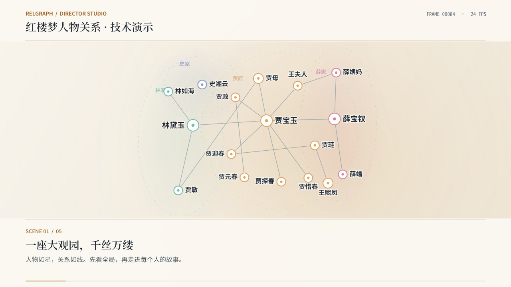 | 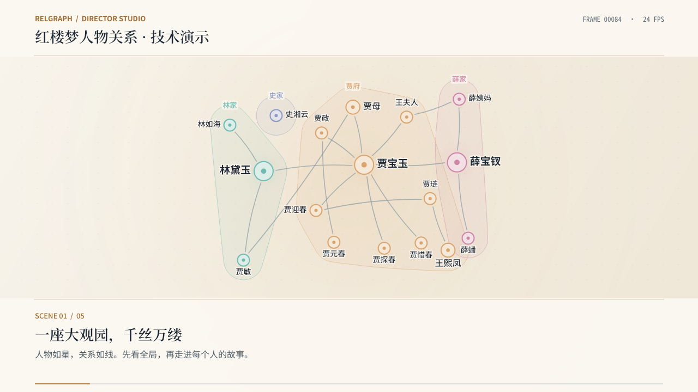 |
| 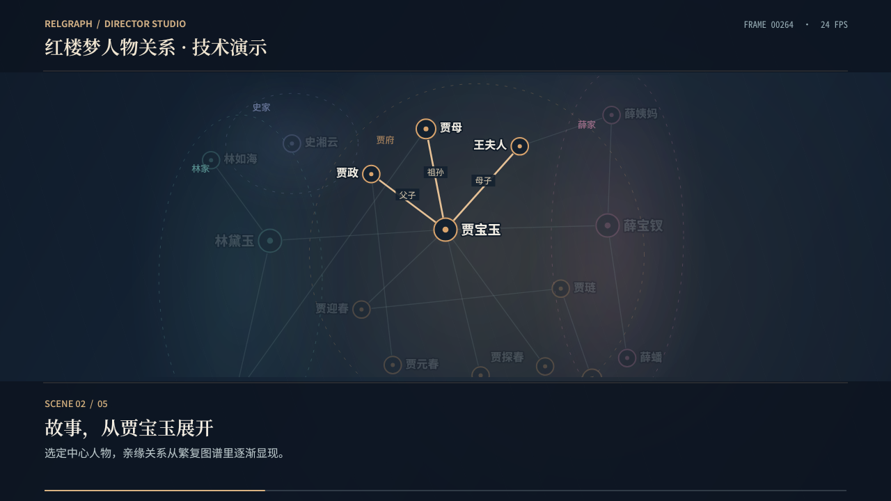   | 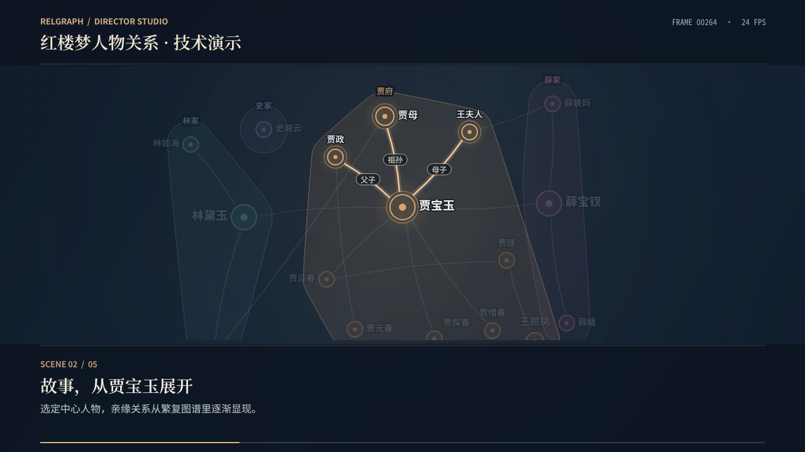   |

The bundled generic example (`examples/bookshop-systems-synthetic.graph.json`)
contains no coordinates and no storyboard. Its layout, colours, shapes,
hierarchy, legend and seven shots are derived:

| Derived film (auto → flow)                                | Derived hub shot, dark                             |
| --------------------------------------------------------- | -------------------------------------------------- |
| 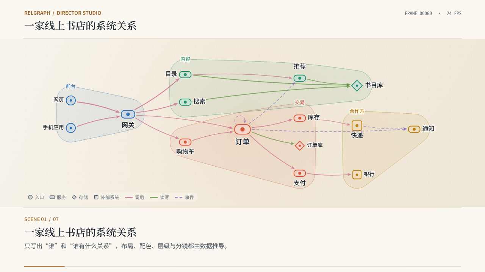 | 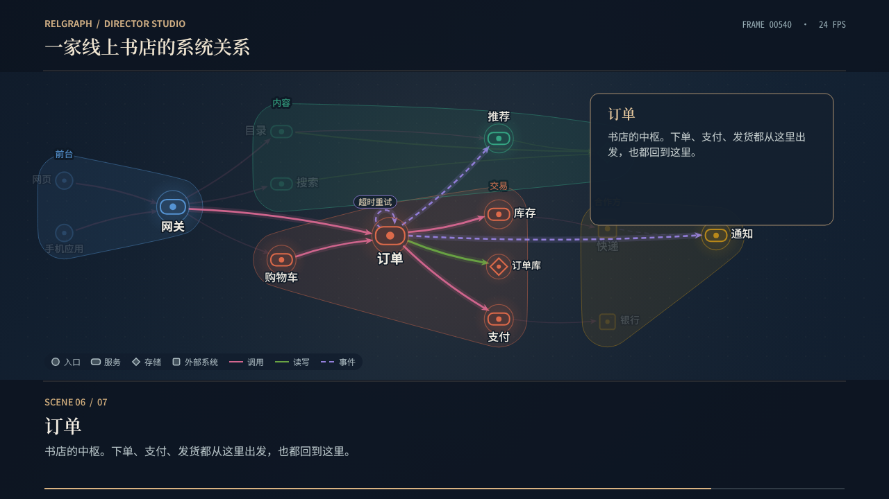       |
| **Force strategy on the same data**                       | **Radial strategy on the same data**               |
| 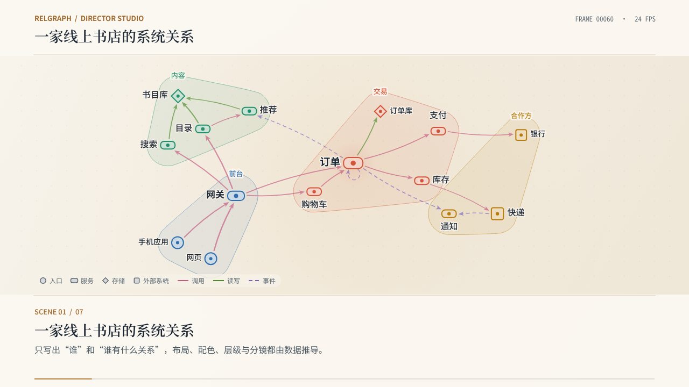         | 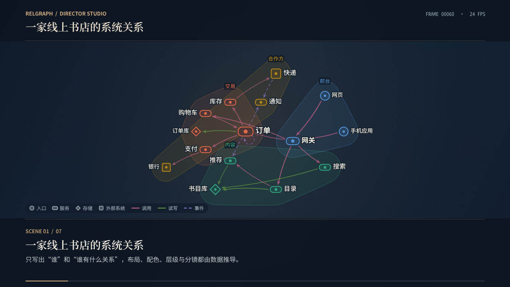 |

## The `relgraph.graph/1` format

The smallest valid document:

```json
{
  "format": "relgraph.graph/1",
  "edges": [
    { "source": "Coffee", "target": "Caffeine", "kind": "contains" },
    { "source": "Caffeine", "target": "Adenosine receptor", "kind": "blocks" }
  ]
}
```

Everything else is optional.

| Field          | Meaning                                                                                                                                                                                                                                                                                                                                                                                   |
| -------------- | ----------------------------------------------------------------------------------------------------------------------------------------------------------------------------------------------------------------------------------------------------------------------------------------------------------------------------------------------------------------------------------------- |
| `meta`         | `title`, `description`, `sourceNote`. The title defaults to `关系图`.                                                                                                                                                                                                                                                                                                                     |
| `directed`     | Default direction of relations (`false`). A kind or a single relation may override it.                                                                                                                                                                                                                                                                                                    |
| `diagram`      | What kind of picture this is: `network` (default), `tree`, `mindmap`, `flowchart` or `timeline`. See [Diagram kinds](#diagram-kinds).                                                                                                                                                                                                                                                     |
| `unfold`       | `false` shows a tree, mind map or flowchart whole instead of revealing it level by level.                                                                                                                                                                                                                                                                                                 |
| `nodes[]`      | `id` (required), `label`, `kind`, `group`, `weight` (≥ 0), `color` (`#RRGGBB`), `summary` (detail card text), `position` `{x, y}` (on a timeline that keeps time, a dated node may give `{y}` alone; see [Diagram kinds](#diagram-kinds)), `visibleFrom`, `visibleTo`, `start`, `end` (a span on the time axis; it never hides the node). A bare string or number is a node with that id. |
| `edges[]`      | `source`, `target` (required), `id`, `kind`, `label`, `directed`, `weight` (≥ 0), `visibleFrom`, `visibleTo`. Endpoints that are not declared become nodes labelled by their id. `source === target` is a self-relation.                                                                                                                                                                  |
| `groups[]`     | `id` (required), `label`, `kind`, `color`. Groups referenced only by nodes are created.                                                                                                                                                                                                                                                                                                   |
| `kinds`        | `nodes.<kind>`: `label`, `color`, `shape` (`circle`, `pill`, `diamond`, `square`, `hexagon`, or the label-holding `box`, `capsule`, `decision`). `edges.<kind>`: `label`, `color`, `line` (`solid`, `dashed`, `dotted`), `head` (`arrow`, `bar`, `hollow-circle`, `none`), `directed`.                                                                                                    |
| `timeline`     | `unit` and optional `total` of the domain time used by `visibleFrom` / `visibleTo`.                                                                                                                                                                                                                                                                                                       |
| `timeAxis`     | `false` declares that a timeline's coordinates are not on its time axis: x is kept as written and no axis is drawn. Written by the studio when it exports a timeline drawn with another strategy. See [Diagram kinds](#diagram-kinds).                                                                                                                                                    |
| `presentation` | Shots, as in the biology format: `id`, `title`, `narration`, `durationSec` (default 4), `transitionMs`, `domainAt`, `camera` (`focusNodeId` \| `fitIds`, `zoom`), `highlight` (`nodeIds`, `edgeIds`, `groupId`), `openDetailNodeId`.                                                                                                                                                      |

Rules worth knowing:

- **Ids are free text or numbers.** A lowercase slug is used as is; any other
  id (`"Alice Smith"`, `"贾宝玉"`, `42`) maps to a stable internal id derived
  from its text. The mapping depends only on the set of ids, never on array
  order, so styles and coordinates saved in a `.studio.json` survive edits
  elsewhere in the file. Shots refer to the ids you wrote.
- **Hierarchy.** If any node has a `weight`, weights set the five-step size
  and type scale; otherwise degree does. Relation `weight` becomes line weight.
- **No storyboard?** One is derived from author text only, so no language is
  assumed: the whole graph, each group (two to six groups), the best-connected
  node with its relations and `summary`, and a closing overview. A graph with
  `visibleFrom` / `visibleTo` instead grows one step per domain time (at most
  twelve steps), which keeps the existing spoiler guarantee.
- **Limits.** 5,000 nodes and 20,000 relations; text fields up to 2,000
  characters. Above 300 nodes or 600 relations the graph still loads, with
  a `LARGE_GRAPH` warning that the preview may stutter (see [Size](#size)).
  Unknown fields are ignored, so exported data can be loaded with its extra
  attributes in place.
- **Diagnostics** use the same shape as the other formats: code, JSON path,
  record id, message and repair.

Coordinate export (`仅导出坐标 JSON`) and `relgraph layout` write back to the
ids you authored and declare nodes that previously existed only as endpoints.

## Size

`GENERIC_LIMITS` holds two kinds of number:

| Limit                                           | Nodes | Relations | Above it                                                                              |
| ----------------------------------------------- | ----- | --------- | ------------------------------------------------------------------------------------- |
| Preview budget (`previewNodes`, `previewEdges`) | 300   | 600       | Loads with the `LARGE_GRAPH` warning: the preview may stutter; export is not affected |
| Hard limit (`nodes`, `edges`)                   | 5,000 | 20,000    | Refused with `TOO_LARGE`                                                              |

The preview budget is set by playback, not by composition alone: a preview
tick composes a frame and then draws it, and at 24 fps it has about 42 ms.
Measured in the review of #41 in the built studio, headless Chromium
(software rasterising, so a desktop with a GPU is faster), synthetic graph:

| Nodes / relations | Playback, frames per second | Tick (compose and draw), mean |
| ----------------- | --------------------------- | ----------------------------- |
| 100 / 200         | 56                          | 6 ms                          |
| 300 / 600         | 31                          | 16 ms                         |
| 500 / 1,000       | 18                          | 29 ms                         |
| 1,000 / 2,000     | 9                           | 63 ms                         |

At 300 / 600 playback still keeps up with 24 fps; at 500 / 1,000 it no
longer does.

Composition alone, measured with `scripts/bench-compose.mjs` on linux-x64,
Node 22.23.4, after `npm run build:packages`; the graph is
`tests/helpers/synthetic-graph.mjs` (six groups, three node and relation
kinds), seven frames across shots with every highlight form, text measured in
constant time. Real frames also measure and draw text, so they are slower.
The default command composes the first four rows; the last row needs
`--sizes 5000 --per-node 4`, since the default of two relations per node gives
5,000 / 10,000.

| Nodes / relations | Compose, 1080p (mean) | Compose, 720p (mean) | Frame state (mean) |
| ----------------- | --------------------- | -------------------- | ------------------ |
| 200 / 400         | 10–19 ms (13)         | —                    | 1.4 ms             |
| 300 / 600         | 15–26 ms (20)         | 17–23 ms (20)        | 2 ms               |
| 500 / 1,000       | 27–40 ms (33)         | 27–42 ms (34)        | 3 ms               |
| 1,500 / 3,000     | 67–115 ms (85)        | —                    | 18 ms              |
| 5,000 / 20,000    | 0.45–0.64 s (0.54)    | —                    | 61 ms              |

Before the per-frame work was reduced (`main` at `a2589bf`), the same frames
took 24, 36, 66, 265 and 3,452 ms on average at 1080p.

How the work grows. Each concern (attention, groups, self-loops, the legend)
is one pass over the view, and every text is measured a bounded number of
times. Label collisions are tested only against rectangles in nearby cells
of a grid. When the camera shows part of a large graph, the density on stage
does not change with the size of the graph, and composition costs a bounded
amount of work per node and relation. A whole-graph shot is different: every
node is on stage, so the stage gets denser as the graph grows and each label
place meets more neighbours. There collision tests still grow faster than the
graph, though far slower than its square: four times the nodes cost about six
times the rectangle tests (`tests/compose-cost.test.mjs` bounds both cases).

## Diagram kinds

Flowcharts, mind maps, trees and timelines are graphs with conventions. A
document names the convention with `diagram`; everything else stays the same
format, the same kernel and the same renderer. Removing the field turns any
of them back into an ordinary network.

| `diagram`   | Layout                   | Nodes                                                                                                                                                         | Relations                                                                                                                                                                   | Derived film                                                                                    |
| ----------- | ------------------------ | ------------------------------------------------------------------------------------------------------------------------------------------------------------- | --------------------------------------------------------------------------------------------------------------------------------------------------------------------------- | ----------------------------------------------------------------------------------------------- |
| `tree`      | `tree`                   | Glyphs with labels beside them; size by depth; one tone per main branch                                                                                       | Elbows without arrowheads, in the child's tone                                                                                                                              | Unfolds one level per shot, lighting the branches that have just arrived, then the whole tree   |
| `mindmap`   | `mindmap`                | Boxes holding their label; the topic in solid colour; one tone per branch                                                                                     | As for trees                                                                                                                                                                | Topic, main branches, details, then the whole map                                               |
| `flowchart` | `flow`                   | Pipelines and processes                                                                                                                                       | The same, left to right, with more room along the reading direction for labels. Relations that return to an earlier step are feedback and do not fold a loop into one rank. |
| `tree`      | Hierarchies and lineages | A tidy tree growing to the right: leaves in written order, each parent midway between its outer children.                                                     |
| `mindmap`   | A topic and its branches | The topic in the middle; main branches shared between right and left so both sides carry a similar load, each side read from the top.                         |
| `timeline`  | Anything with dates      | x is time. A tree keeps its leaf order (a phylogram); anything else is packed into lanes, per group, so spans never overlap. Without dates it draws the tree. |
| `timeline`  | `timeline`               | Bars as long as `start`…`end`; points for nodes with only a first appearance                                                                                  | Elbows                                                                                                                                                                      | Travels along the axis: one shot per start, a cursor at the film's present, then the whole axis |

| Tree unfolding (dark)                                              | Tree, whole                                              |
| ------------------------------------------------------------------ | -------------------------------------------------------- |
| 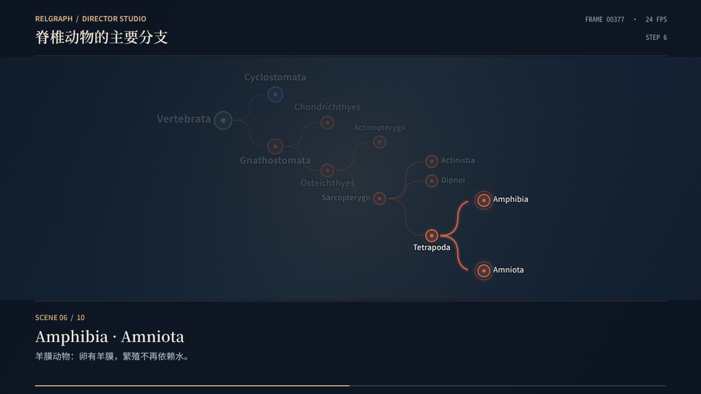 | 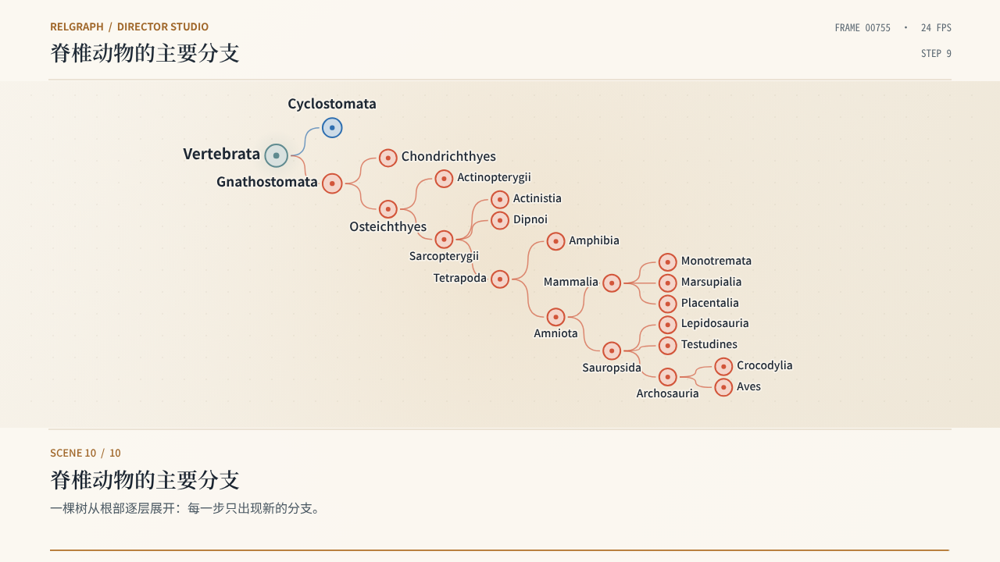          |
| **Timeline travelling**                                            | **Timeline, whole (dark)**                               |
| 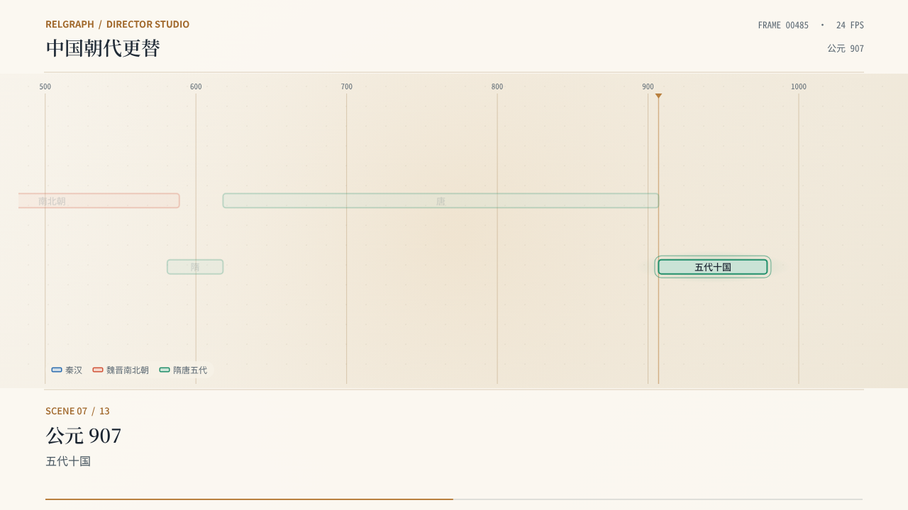 | 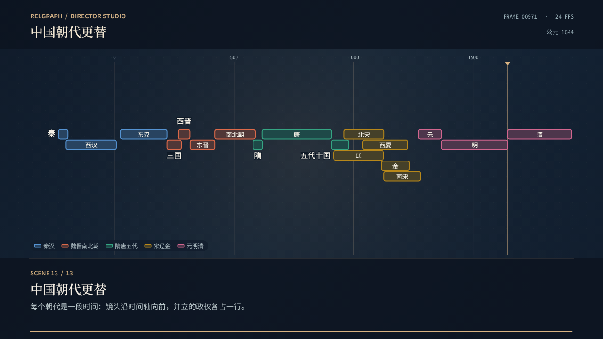   |
| **Mind map**                                                       | **Flowchart (dark)**                                     |
| 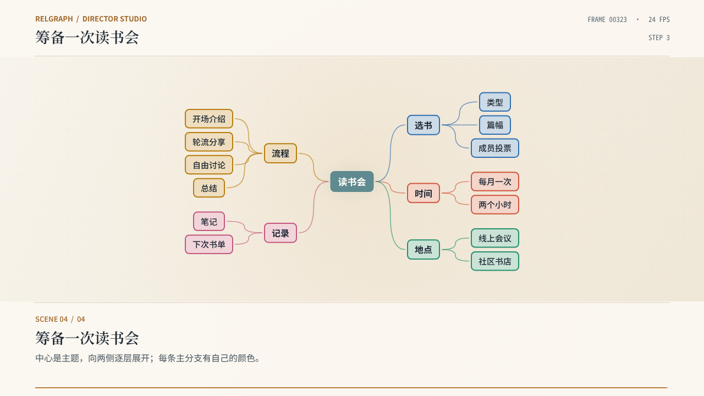             | 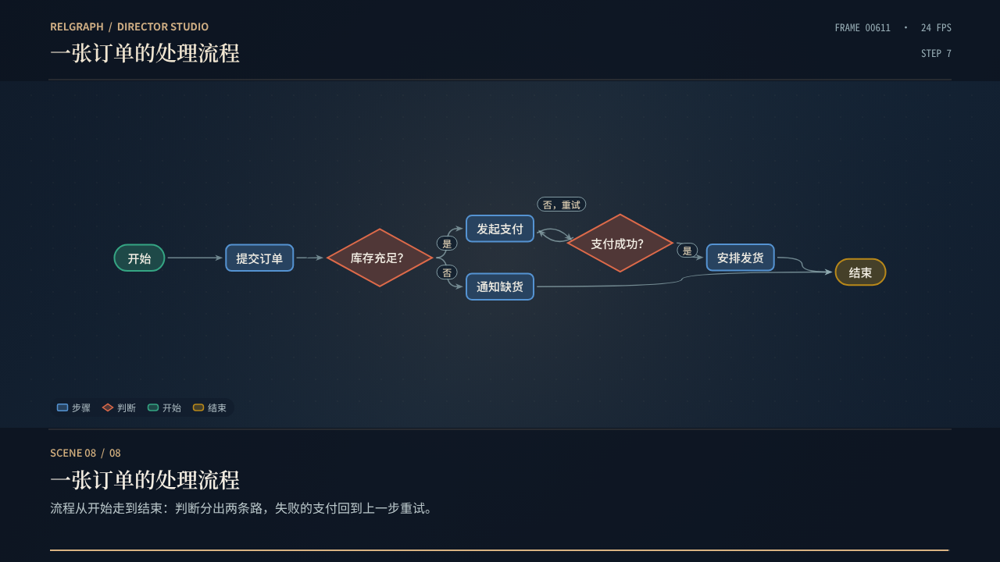 |

A timeline stays a timeline. Whether a drawing is on its time axis is a
declared state, and one definition (`timeAnchor`) serves the editor, the layout
panel, the player, the CLI and the renderer. A timeline is on its axis while
no strategy was applied and the source does not say `"timeAxis": false`, or
while it is drawn with the `auto` or `timeline` strategy. Then a dated node's x
is its place in time and only its lane (y) is stored and edited: dragging a
bar sideways does nothing, a changed `start` or `end` moves the bar to its new
years, and a dated node added without coordinates (in the player or by
`relgraph layout`) takes the first free lane, one of the drawing's own lane
steps below the others when none is free. A lock holds a dated node's lane;
its x is its date.

Because x is derived, the file stores the lane alone. A positioned source
exported from the studio, and a node added by `relgraph layout`, write a dated
node of such a timeline as `"position": { "y": 126 }`, and loading derives x
from its dates. Editing a date, moving the end of the axis or adding a dated
node (both rescale the axis) therefore leaves nothing stale in the file. A
lane-only position takes x from the node's dates only for a dated node, on a
timeline that does not say `"timeAxis": false` and has an axis (at least two
distinct times). Anywhere else the node is unplaced: the layout puts it in a
free place and a `LANE_ONLY` warning at that node's `nodes[i].position` says
to add x. Source validation reports the same warning as loading. **This
fallback discards the original y as well**: it is a new placement, not a
layout with y held fixed. This applies when `timeAxis` is changed to `false`,
the diagram kind changes, a node loses its date, or dates no longer define
an axis. To keep an arrangement while disabling the axis by hand, first
supply a full `{x, y}` position for each lane-only node. In the studio,
apply the desired off-axis layout strategy, adjust the positions, then
export; that writes full coordinates together with `"timeAxis": false`.
While there is no axis yet, x is layout, not a date, so it is stored; once
dates make an axis, that
x is reported with `OFF_TIME_AXIS` until the positioned source is exported
again.

Applying another strategy in the layout panel is the explicit way off the
axis; the spans are then drawn as points, in the legend as well. Exporting the
positioned source writes `"timeAxis": false` for such a drawing, so it stays
off the axis when the file is read again; applying `timeline` or `auto` puts
it back, and the next export removes the field. Coordinates written by hand
that are off the axis, without that field, are drawn at their dates with an
`OFF_TIME_AXIS` warning. It names both ways out: remove the x and keep the
lane (re-exporting the positioned source does this, which also repairs a file
written with x before lanes were stored alone), or declare `"timeAxis": false`
to keep x and draw no axis.

The layout panel previews a strategy only when it changes something: a
coordinate, or whether the drawing is on its axis. A strategy on the axis is
refused while a locked dated node sits away from its date, since applying it
would have to move that node; unlock it or choose another strategy. Reset
restores the loaded coordinates together with the strategy they were loaded
with, and is refused in the same way when the loaded axis would move a locked
node. Exporting a timeline that has no dates yet does not write
`"timeAxis": false`: once dates are added, it is drawn on its axis.

The unfolding of a tree, mind map or flowchart counts reveal order, not time,
so its frames show no domain time.

An evolutionary tree that unfolds needs nothing but its branches:

```json
{
  "format": "relgraph.graph/1",
  "diagram": "tree",
  "edges": [
    { "source": "Tetrapoda", "target": "Amphibia" },
    { "source": "Tetrapoda", "target": "Amniota" },
    { "source": "Amniota", "target": "Mammalia" },
    { "source": "Amniota", "target": "Sauropsida" }
  ]
}
```

Civilisations over time need spans:

```json
{
  "format": "relgraph.graph/1",
  "diagram": "timeline",
  "timeline": { "unit": "公元" },
  "nodes": [
    { "id": "唐", "start": 618, "end": 907 },
    { "id": "辽", "start": 916, "end": 1125 },
    { "id": "北宋", "start": 960, "end": 1127 }
  ]
}
```

How the conventions are derived, and how to override them:

- **Where it begins.** A tree or mind map starts at the node nothing points
  to, or at the centre of the graph when relations are undirected. In these
  kinds and in flowcharts a relation runs from `source` on unless `directed`
  says otherwise. Siblings keep the order in which they were written.
- **Unfolding.** Without a `presentation` and without timed facts, each node
  appears at its depth (trees, mind maps) or step (flowcharts); very deep
  diagrams are folded into twelve steps. `unfold: false`, your own
  `visibleFrom` values or your own `presentation` always win. A tree whose
  nodes carry dates is revealed by those dates, and with `diagram: "timeline"`
  it is drawn as a phylogram: time along x, leaves in reading order.
- **Time.** `start` and `end` place a node on the axis and set the length of
  its bar; a span without `end` runs to the end of the axis. Unlike
  `visibleTo`, a span never hides the node: what has ended stays on screen.
  Spans that overlap never share a lane; with groups, each group has its own
  band of lanes. The axis, its cursor and the bars are drawn only while the
  drawing is on its time axis (see above); lanes (y) remain yours to choose.
  A drawing taken off the axis is shown without it and with spans as points,
  rather than with rules that point at the wrong years. The reveal steps of
  an unfolding tree, mind map or flowchart are not dates: the timeline
  strategy draws such a graph as a tree, and says so.
- **Shapes.** In a flowchart, kinds named like `开始`, `结束`, `start`, `end`
  become capsules and kinds named like `判断`, `条件`, `decision` become
  diamonds; everything else is a box. `kinds.nodes.<kind>.shape` overrides.
  Label-holding shapes are sized by their text (two lines at most) with a
  canvas-independent estimate, so hit tests, edge attachments and both
  backends agree.
- **Routing.** Elbow links leave and arrive level and are built from two
  quadratic arcs, so they are drawn partially with the same exact prefix as
  every other relation. A pair joined both ways opens into two arcs, and a
  relation tag that does not fit between two shapes steps aside.

Every strategy can also be chosen in the studio for any graph, so a literary
network can be tried as a tree or laid out on a timeline.

## Derived visual encoding

`styleForGraph(graph)` returns the registered sheet for `literature` and
`biology`, and derives one for every other domain. Channels are allocated once
per document, never per frame, so a reveal cannot repaint what is on screen:

1. **Node hue** belongs to the branches of a tree or mind map, then to groups
   when the graph has any (in declaration order), otherwise to node kinds. A
   single kind without groups stays neutral. Where branches or groups own the
   hue, node kinds are told apart by shape alone.
2. **Node shape** follows the node kind: circle, pill, diamond, square,
   hexagon, most frequent kind first.
3. **Relation hue** follows the relation kind and takes only palette slots
   that no branch, group or node kind uses, so one hue never means two
   things. A group with a `color` of its own holds no slot. From the fourth
   kind on, a dash rhythm is added as a second channel.
4. **Past eight tones nothing is cycled or generated.** Further node kinds
   keep their shape. Further relation kinds fold to the neutral stroke, each
   with a dash rhythm of its own (the first solid); the legend names them.
5. `kinds` declarations override the automatic choice for their kind.

Literary relation kinds now have curated tones (kinship blue, marriage
cinnabar, romance rouge, friendship malachite, alliance gamboge, mentorship
green, rivalry violet and dashed, service ochre and dotted). Biology keeps its
role encoding and protected endpoint markers unchanged.

### Palette

Each theme carries eight categorical tones for the same eight slots:

| Slot | Light     | Dark      |
| ---- | --------- | --------- |
| 0    | `#2f6fb0` | `#5593d2` |
| 1    | `#d2553a` | `#dd6a4a` |
| 2    | `#23906c` | `#35a583` |
| 3    | `#b87d0c` | `#b8881a` |
| 4    | `#c4577f` | `#d2668f` |
| 5    | `#4d8a2c` | `#69a343` |
| 6    | `#7a5fc0` | `#9480dc` |
| 7    | `#a8643c` | `#c47f4c` |

Both sets were checked against their own stage surface (`#f3ede1`, `#152638`)
for the OKLCH lightness band, the chroma floor, adjacent-pair separation under
simulated protanopia and deuteranopia (worst pair ΔE 8.6 light, 8.8 dark,
target ≥ 8), the normal-vision floor (17.2 / 16.6, floor 15) and 3:1 contrast.
Any two marks can be neighbours in a network, which no eight hues can satisfy
pairwise, so identity never rests on hue alone: shape, dash rhythm, direct
labels and the legend carry it as well.

## Layout strategies

All engines are pure functions of the graph and their options: ids are sorted
before traversal, the only randomness is a seeded hash of node ids, and step
counts are bounded. None of them runs during playback.

| Strategy  | Use it for                    | What it does                                                                                                                                                                |
| --------- | ----------------------------- | --------------------------------------------------------------------------------------------------------------------------------------------------------------------------- |
| `auto`    | Anything                      | No relations → `grid`; mostly directed and acyclic → `layered` when broad, `flow` when deep; a forest → `radial`; otherwise `force`.                                        |
| `force`   | Communities, general networks | Fruchterman–Reingold from a radial start, group cohesion, a principal-axis turn and gentle lowering to fit the stage, guaranteed room between nodes. Honours fixed anchors. |
| `layered` | Hierarchies, top to bottom    | Ranks from structure (cycles share a rank), barycentre sweeps against crossings, groups kept as bands, rows pulled under what they connect to.                              |
| `flow`    | Pipelines and processes       | The same, left to right, with more room along the reading direction for labels.                                                                                             |
| `radial`  | Trees and ego networks        | Rings around the graph centre (least eccentricity), each subtree in a wedge sized by its leaves, ring radii grown until siblings have room.                                 |
| `circle`  | Showing who connects to whom  | One ring; groups stay contiguous and neighbours are drawn towards each other.                                                                                               |
| `grid`    | Sets and lists                | A tidy matrix per group. Like `tree` and `mindmap`, it keeps the author's order.                                                                                            |

A document with **no coordinates at all** is arranged when it is loaded
(studio and CLI alike): by its `diagram` kind if it names one, otherwise by
`auto`. A partly positioned document keeps the previous
conservative fallback, which never moves or crowds authored nodes. Locks and
the `保留 / 填补 / 重排` policies work with every strategy.

`auto` never chooses `force` for more than 1500 nodes: the pairwise model
would hold the page for seconds, so such a graph gets the `grid`. The player,
`relgraph layout` and the studio's `auto` share that one choice
(`chooseLayoutEngine`, `structuralLayout`). `force` can still be asked for by
name.

## How the network is drawn

- **Hulls** are the smoothed convex hull of circles around each member. A
  member that is still being revealed pulls the hull out as it arrives, and a
  hull recedes with its members when another part of the graph is in focus.
- **Relations** bow slightly, all relations of a hub turning the same way.
  Arrowheads are swept back, the stroke ends at their notch, and they ride the
  tip while a relation is drawn. A highlighted relation gains weight and a
  soft glow in its own colour; its label is a rounded tag on the line.
- **Nodes** carry a tint of their colour as body, a ring, and a centre pip.
  Size and label type follow one scale. Only nodes that a shot names get a
  focus ring and light; previously every undimmed node glowed.
- **Labels** try the side their relations leave free first. Among the
  positions that stay on stage and cover no glyph or text, the one that
  crosses the fewest relations and cannot be read as a neighbour's name wins.
- **Legend**: bottom left of the stage, only kinds that are visible now, only
  when there is more than one. Kinds captioned on their own edges (biology)
  need no entry.
- **Ground**: the diagonal hatch is replaced by a quiet dot lattice.

Every length still derives from `FrameSpec`; the 1080p composition of all
seven examples is exactly the 720p composition scaled by 1.5.

## Compatibility

- Literary and biological documents load exactly as before. Their pixels
  change by design; the golden frames were regenerated (see below).
- `VisualGraph` gains optional `kinds`, `VisualGroup` an optional `tone`,
  `DomainStyle` optional `curvature` and per-kind `tone` / `color`. Existing
  custom style sheets remain valid.
- `ProjectConfig.layout.type` accepts the new strategies; shapes accept
  `square`, `hexagon`, `box`, `capsule` and `decision`. Older projects
  validate unchanged.
- `VisualGraph` gains optional `diagram`; `VisualNode` optional `tone` and
  `span`; `DomainStyle` optional `routing`, `edgeLabels`, `edgeHue` and
  `timeAxis`.
- The kernel no longer rejects `source === target`; the literary and
  biological validators still do.
- `layoutGraph` now returns a structural layout for documents without any
  coordinates. Callers that relied on the four-column grid for such documents
  should store coordinates or choose a strategy explicitly.

## Verification

Run locally on linux-x64, Node 22.23.4, skia-canvas 4.0.0, Chromium 153, after
merging `main` at `0f995b7` (Prettier pass #36 and the EGFR–MAPK example #37):

- `npm test`: 356 tests in 33 files, including `tests/generic-graph.test.mjs`,
  `tests/layout-engines.test.mjs` and `tests/diagrams.test.mjs`, and 236
  golden frames (five examples, two themes) against the native renderer.
- `npm run typecheck`, `npm run check:types`, `npm run lint`,
  `npm run format:check`.
- `npm run check:export -- --update`, then `npm run check:export`: golden
  hashes, H.264 exports of the five examples with matching frame counts, and
  decoded-frame PSNR against PNG renders.
- `npm run check:browser`: 75 checks in real Chromium, including the generic
  example with all ten strategies and the four diagram examples, each with
  pixel-identical repeats.

The mind-map and flowchart examples are covered by the display-list tests and
the browser check rather than by golden frames.

No GitHub Actions workflow was added, dispatched or rerun.
